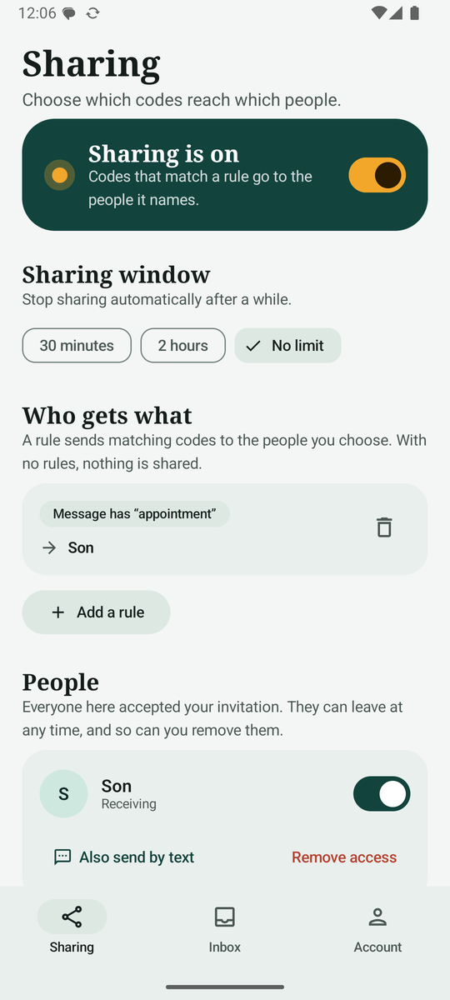
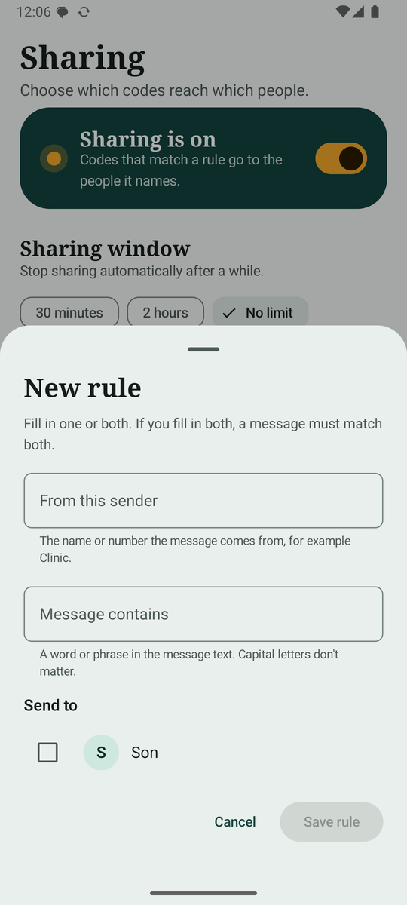
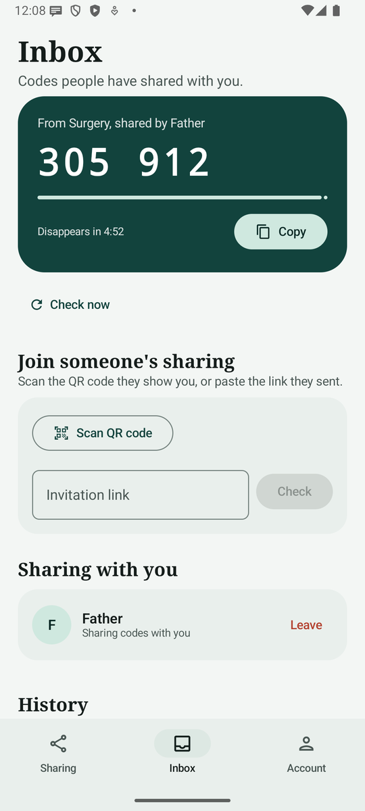
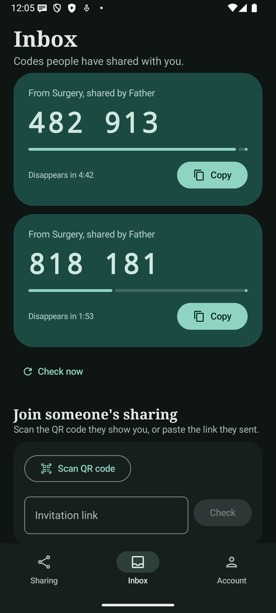

# OTP Forwarder

**Share a code, not your phone.**

An Android app that lets the owner of a phone number knowingly share the one-time codes (OTPs) that arrive on it with people they trust. Think of a son who manages his mother's medical records, or two people on a joint account with one phone number.

Consent is the point. Nothing is shared until the owner opts in, nobody receives anything until they accept an invitation, either side can leave at any time, and a persistent notification shows whenever sharing is on.

| Sharing (owner) | Routing rule | Inbox (recipient) | Dark mode |
|---|---|---|---|
|  |  |  |  |

## What it does

- **Owner phone** captures incoming SMS, decides who (if anyone) may receive each code, encrypts it for that person, and uploads the ciphertext.
- **Recipient phone** receives it, decrypts it locally, and shows it large and grouped (`482 913`) with a countdown. Codes live in memory only and disappear after 5 minutes.
- **Routing rules** decide who gets what. A rule matches the **sender**, the **message text**, or both, and names the people who receive it. For example: *From `Clinic` goes to Son 1*; *message contains `account` goes to Son 2*.
- **Everything is visible.** Every shared code is logged (time, sender, recipient, never the code itself), and the log cannot be turned off.

## Consent and safety by design

| Risk | What the app does |
|---|---|
| Silent interception | Off until the owner accepts a notice and switches it on. A persistent "sharing is on" notification stays up. No hidden icon or stealth mode. |
| Adding someone who didn't agree | Single-use invitation (QR or link, 10 minutes). The recipient must tap **Accept**. |
| "Forward everything" | There is no such mode. With no rules, nothing is shared. |
| Access after trust is lost | Either side can end it any time. The owner's phone checks the server before every forward. Per-person pause, time window (30 min, 2 h) and a kill switch. |
| Server breach | Codes are end-to-end encrypted (HPKE, X25519 and AES-256-GCM). The server stores only short-lived ciphertext and never the code. |
| Matching text leaks | Rules are stored and evaluated on the owner's phone only. |

More in [docs/THREAT_MODEL.md](docs/THREAT_MODEL.md) and [docs/PRIVACY.md](docs/PRIVACY.md).

> **Heads up:** many banks and services forbid sharing one-time codes. Use this only where that is allowed and with the account holder's consent. Where a provider offers proper delegated access, prefer that.

## How it works

```
  OWNER PHONE                          FIREBASE                       RECIPIENT PHONE
  ───────────                          ────────                       ───────────────
  SMS arrives
    │  OtpParser: find the code
    │  ForwardingPolicy: rules, window, pause
    │  encrypt for each recipient's key
    ▼
  upload ciphertext + audit entry ───▶ otp_messages (10 min TTL)
                                       Cloud Function ─── push ─────▶ wake the app
                                                                          │ fetch, decrypt, delete
                                                                          ▼
                                                                      Inbox (memory, 5 min)
```

Identity is an anonymous Firebase ID plus the display name you choose: no email, phone number or password. Pairing is by invitation token; encryption keys are per device and live in the Android Keystore.

## Tech stack

Kotlin, Jetpack Compose (Material 3), Firebase (Auth, Firestore, Cloud Messaging, Cloud Functions), Tink (HPKE), ZXing and ML Kit code scanner for invitations. Min SDK 26, target SDK 35.

## Getting started

**Prerequisites:** JDK 17+, Android SDK (API 35), a Firebase project.

1. **Set up Firebase and the database.** Follow **[docs/FIREBASE_SETUP.md](docs/FIREBASE_SETUP.md)**. You need an Anonymous sign-in provider, a Native-mode Firestore database, the security rules, and `app/google-services.json`.
2. **Build and run**
   ```bash
   ./gradlew :app:assembleDebug        # debug APK in app/build/outputs/apk/debug
   ./gradlew :app:testDebugUnitTest    # unit tests
   ```
   Without `app/google-services.json` the app still builds and shows a "Not connected" screen.
3. **Try it end to end on two emulators** (use a Google Play system image):
   ```bash
   emulator -avd Phone -read-only -port 5554 &      # owner
   emulator -avd Phone -read-only -port 5556 &      # recipient
   adb -s emulator-5554 install app/build/outputs/apk/debug/app-debug.apk
   adb -s emulator-5556 install app/build/outputs/apk/debug/app-debug.apk
   adb -s emulator-5554 shell pm grant com.otpforwarder android.permission.RECEIVE_SMS
   ```
   On the owner: turn sharing on, **Invite someone** and copy the link. On the recipient: paste it under *Join someone's sharing* and accept. Then add a rule on the owner and send a test message:
   ```bash
   adb -s emulator-5554 emu sms send Clinic "Your verification code is 482913"
   ```
   Tap **Check now** on the recipient (instant delivery needs the push function, see the Firebase guide).

## Project layout

```
app/src/main/java/com/otpforwarder/
  capture/    SMS receiver, split-message reassembly, foreground service, boot restart
  parse/      OtpParser (English and Hebrew; ignores amounts and phone numbers)
  policy/     ForwardingPolicy: routing rules, window, pause; RateLimiter
  crypto/     HPKE encryption (Tink) with Keystore-backed device keys
  data/       Cloud (Firebase wrapper), PolicyStore, prefs
  delivery/   Forwarder, SMS relay, inbox, notifications, push service
  ui/         Compose screens and theme
firestore.rules      security rules
functions/           push sender and cleanup (Cloud Functions)
rules-test/          Firestore rules tests (emulator)
docs/                threat model, privacy, Firebase guide, screenshots
```

## Tests

- **Unit tests (JVM):** parser, policy matrix (including multi-recipient routing and Hebrew text), SMS reassembly, HPKE round trip. Run `./gradlew :app:testDebugUnitTest`.
- **Rules tests:** `rules-test/` runs against the Firestore emulator (see the Firebase guide).
- **Verified by hand on two emulators:** pairing, sender and text rules, blocked senders, revoke, pause, popup behaviour, dark mode.

## Status and limits

- Sideload build: it uses the SMS permission, which Google Play restricts to default SMS apps. Capture sits behind the `OtpSource` interface so a Play-compliant source can be added later.
- Instant push needs the Cloud Function deployed (Firebase Blaze plan). Without it, recipients tap **Check now**.
- Not yet tested: the optional SMS-relay backup and the Firestore rules tests.
- Reinstalling or changing phones starts a fresh identity and keys, so people pair again.
- Display names are chosen by users and are not verified. Hand invitations over in person or through a channel you trust.

## License

Not yet chosen.
